<!--
  GENERATED FILE — do not edit by hand.
  Every change here is overwritten by `npm run build`, which regenerates this
  page from https://getbb.app/marketplace/v1/marketplace.json
-->

<h1 align="center">bb plugins</h1>

<p align="center"><b>10 plugins for <a href="https://getbb.app">bb</a>, the agent IDE.</b><br>Each one is in the BB Community marketplace and installs with one command.</p>

<p align="center">

<a href="https://github.com/get-bb/marketplace"></a>
<a href="LICENSE"></a>
</p>

<picture>
  <source media="(prefers-color-scheme: dark)" srcset="assets/hero-dark.svg">
  
</picture>

## Install

All of these are listed in the [BB Community marketplace](https://github.com/get-bb/marketplace), so bb installs them by name:

```sh
bb plugin install <name>
```

> [!TIP]
> Or browse them inside bb under **Settings → Plugins**. Updates arrive the same way.

## Plugins

<table>
<tr>
<td width="50%" valign="top">

<a href="https://github.com/vburojevic/bb-plugin-xcode"></a>

### <picture><source media="(prefers-color-scheme: dark)" srcset="icons/xcode-dark.svg"></picture> [Xcode](https://github.com/vburojevic/bb-plugin-xcode) <a href="https://github.com/vburojevic/bb-plugin-xcode/releases/latest"></a>

Every Xcode build on your machine tracked live with zero configuration — and the simulators they run on, streamed and fully touchable, in your bb sidebar.

```sh
bb plugin install xcode
```

<details>
<summary>More about Xcode</summary>

Tracks every Xcode build and test on the machine with no per-project configuration — live progress, verdicts, errors with file:line, history and trends — and streams the simulators they run on into the panel with full touch input, a build-aware device picker, SwiftUI preview diffs, and gated agent tools.

<sub>xcode · ios · simulator · builds · tests · swiftui</sub>
</details>

</td>
<td width="50%" valign="top">

<a href="https://github.com/vburojevic/bb-plugin-handoff"><picture><source media="(prefers-color-scheme: dark)" srcset="https://raw.githubusercontent.com/vburojevic/bb-plugin-handoff/HEAD/assets/screenshots/handoff-panel-dark.png"></picture></a>

### <picture><source media="(prefers-color-scheme: dark)" srcset="icons/handoff-dark.svg"></picture> [Handoff](https://github.com/vburojevic/bb-plugin-handoff) <a href="https://github.com/vburojevic/bb-plugin-handoff/releases/latest"></a>

Move a whole session between agents and machines in both directions — hand a bb thread off to Codex, Claude Code, Kimi or opencode, or adopt an outside terminal session as a bb thread.

```sh
bb plugin install handoff
```

<details>
<summary>More about Handoff</summary>

Moves a whole session between agents and machines in both directions: hands a bb thread's rendered transcript to another provider (optionally on another enrolled machine, carrying uncommitted work as a patch), or adopts a Claude Code, Codex, Gemini CLI or OpenCode session from your terminal as a bb thread in the same directory.

<sub>handoff · session · transcript · providers · machines · claude-code</sub>
</details>

</td>
</tr>
<tr>
<td width="50%" valign="top">

<a href="https://github.com/vburojevic/bb-plugin-floating-terminal"><picture><source media="(prefers-color-scheme: dark)" srcset="https://raw.githubusercontent.com/vburojevic/bb-plugin-floating-terminal/HEAD/docs/media/dark/hero.png"></picture></a>

### <picture><source media="(prefers-color-scheme: dark)" srcset="icons/floating-terminal-dark.svg"></picture> [Floating Terminal](https://github.com/vburojevic/bb-plugin-floating-terminal) <a href="https://github.com/vburojevic/bb-plugin-floating-terminal/releases/latest"></a>

A draggable terminal window for bb — tabbed PTY shells in any project or machine, opened from the sidebar footer or Ctrl+`, that keep running while it is hidden.

```sh
bb plugin install floating-terminal
```

<details>
<summary>More about Floating Terminal</summary>

Adds a draggable terminal window over bb, opened from the sidebar footer or Ctrl+`, with a tab per shell in any project checkout or machine home directory; tabs are persisted, so a reload or a bb restart reattaches to the same shells with their scrollback.

<sub>terminal · shell · developer-tools · xterm · pty · tabs</sub>
</details>

</td>
<td width="50%" valign="top">

<a href="https://github.com/vburojevic/bb-plugin-floating-notes"><picture><source media="(prefers-color-scheme: dark)" srcset="https://raw.githubusercontent.com/vburojevic/bb-plugin-floating-notes/HEAD/docs/media/dark/hero.png"></picture></a>

### <picture><source media="(prefers-color-scheme: dark)" srcset="icons/floating-notes-dark.svg"></picture> [Floating Notes](https://github.com/vburojevic/bb-plugin-floating-notes) <a href="https://github.com/vburojevic/bb-plugin-floating-notes/releases/latest"></a>

Sticky notes that float over your bb agents: a notes window a keystroke away, stickies pinned to a thread or project, per-thread scratchpads, and a live-markdown editor.

```sh
bb plugin install floating-notes
```

<details>
<summary>More about Floating Notes</summary>

Keep a note beside the work it belongs to, one keystroke from any thread. Notes group themselves by project, thread and day, so nothing lands in a flat pile. Stickies pin to a thread or a project and appear only while you are looking at it, and every thread gets a scratchpad your agents can append findings to. Writes real markdown — clickable checklists, highlighted code fences, wiki links — and stores everything in a local SQLite file with no account and no network.

<sub>notes · sticky-notes · markdown · scratchpad · checklists · capture</sub>
</details>

</td>
</tr>
<tr>
<td width="50%" valign="top">

<a href="https://github.com/vburojevic/bb-plugin-prompts"><picture><source media="(prefers-color-scheme: dark)" srcset="https://raw.githubusercontent.com/vburojevic/bb-plugin-prompts/HEAD/assets/screenshots/queue-dark.png"></picture></a>

### <picture><source media="(prefers-color-scheme: dark)" srcset="icons/prompts-dark.svg"></picture> [Prompts](https://github.com/vburojevic/bb-plugin-prompts) <a href="https://github.com/vburojevic/bb-plugin-prompts/releases/latest"></a>

Prompt queue + snippet library for bb: stash prompts while an agent works, auto-send or schedule them, and keep reusable {{fill-in}} templates.

```sh
bb plugin install prompts
```

<details>
<summary>More about Prompts</summary>

Stashes prompts you write while an agent is busy and injects, schedules, or auto-sends them when it next goes idle, alongside a searchable snippet library with {{fill-in}} templates.

<sub>prompts · queue · snippets · templates · composer · scheduling</sub>
</details>

</td>
<td width="50%" valign="top">

<a href="https://github.com/vburojevic/bb-plugin-prompt-enhancer"><picture><source media="(prefers-color-scheme: dark)" srcset="https://raw.githubusercontent.com/vburojevic/bb-plugin-prompt-enhancer/HEAD/assets/screenshots/hero-dark.png"></picture></a>

### <picture><source media="(prefers-color-scheme: dark)" srcset="icons/prompt-enhancer-dark.svg"></picture> [Prompt Enhancer](https://github.com/vburojevic/bb-plugin-prompt-enhancer) <a href="https://github.com/vburojevic/bb-plugin-prompt-enhancer/releases/latest"></a>

Rewrites your rough composer draft into a prompt worth sending — in place, via a hidden bb thread

```sh
bb plugin install prompt-enhancer
```

<details>
<summary>More about Prompt Enhancer</summary>

Rewrites the composer draft into a clearer prompt through a hidden bb thread, keeping follow-ups short, preserving @mentions and file paths, and offering Undo.

<sub>composer · prompt · writing · interface · keyboard-shortcuts</sub>
</details>

</td>
</tr>
<tr>
<td width="50%" valign="top">

<a href="https://github.com/vburojevic/bb-plugin-iris"><picture><source media="(prefers-color-scheme: dark)" srcset="https://raw.githubusercontent.com/vburojevic/bb-plugin-iris/HEAD/docs/hero-dark.png"></picture></a>

### <picture><source media="(prefers-color-scheme: dark)" srcset="icons/iris-dark.svg"></picture> [Iris](https://github.com/vburojevic/bb-plugin-iris) <a href="https://github.com/vburojevic/bb-plugin-iris/releases/latest"></a>

Iris: live, interactive UI in bb chat. Agents draw charts, tables, plans, diffs, test runs, pickers and small apps in your theme.

```sh
bb plugin install iris
```

<details>
<summary>More about Iris</summary>

Turns agent replies into live cards you can use: charts, test runs, decisions, plans and small apps, drawn in your bb theme. Agents pick from 120 components on their own and check each card before you see it, so a status report arrives as metrics and progress, and proof of done as criteria with their evidence. Sliders and toggles recompute cards in place, buttons and pickers send your answer back to the agent, and live cards re-read files every 2 seconds while a job runs. Pin a card to keep it live beside the conversation, or open any card in the web playground. Cards also read bb itself: the thread's context use, the threads it started, its pull request, commits, terminals and plan usage. Adds about 3,500 tokens of instructions to each top-level session, and maps and photos call OpenStreetMap, Photon and Wikimedia Commons unless you turn web lookups off.

<sub>inline-ui · generative-ui · charts · interactive · components · test-reports</sub>
</details>

</td>
<td width="50%" valign="top">

<a href="https://github.com/vburojevic/bb-plugin-linear"><picture><source media="(prefers-color-scheme: dark)" srcset="https://raw.githubusercontent.com/vburojevic/bb-plugin-linear/HEAD/assets/readme/panel-dark.png"></picture></a>

### <picture><source media="(prefers-color-scheme: dark)" srcset="icons/linear-dark.svg"></picture> [Linear](https://github.com/vburojevic/bb-plugin-linear) <a href="https://github.com/vburojevic/bb-plugin-linear/releases/latest"></a>

Linear inside bb — issues, inbox, projects and cycles, with every thread knowing which issue it works on

```sh
bb plugin install linear
```

<details>
<summary>More about Linear</summary>

Linear inside bb — a list-first issue browser, inbox, and create dialog served from a local mirror, thirteen linear_* agent tools, a bb linear CLI, and every thread resolving which issue it works on, shown live in the header and side panel and injected into agent context.

<sub>linear · issues · issue-tracking · inbox · agent-tools · threads</sub>
</details>

</td>
</tr>
<tr>
<td width="50%" valign="top">

<a href="https://github.com/vburojevic/bb-plugin-pets"><picture><source media="(prefers-color-scheme: dark)" srcset="https://raw.githubusercontent.com/vburojevic/bb-plugin-pets/HEAD/docs/media/hero-dark.gif"></picture></a>

### <picture><source media="(prefers-color-scheme: dark)" srcset="icons/pets-dark.svg"></picture> [Pets](https://github.com/vburojevic/bb-plugin-pets) <a href="https://github.com/vburojevic/bb-plugin-pets/releases/latest"></a>

An AI-hatched pixel companion that lives in your bb window, reacts to your agents, and levels up from real work.

```sh
bb plugin install pets
```

<details>
<summary>More about Pets</summary>

Adds a pixel companion to the BB window that mirrors your fleet, walks to threads waiting on you, and earns XP from finished turns.

<sub>companion · interface · pixel-art · threads · ai-art</sub>
</details>

</td>
<td width="50%" valign="top">

<a href="https://github.com/vburojevic/bb-plugin-ayu"><picture><source media="(prefers-color-scheme: dark)" srcset="https://raw.githubusercontent.com/vburojevic/bb-plugin-ayu/HEAD/assets/screenshots/hero-dark.png"></picture></a>

### <picture><source media="(prefers-color-scheme: dark)" srcset="icons/ayu-dark.svg"></picture> [Ayu](https://github.com/vburojevic/bb-plugin-ayu) <a href="https://github.com/vburojevic/bb-plugin-ayu/releases/latest"></a>

The three ayu themes for BB — Light, Dark, Mirage — with a palette explorer and a bb ayu colour CLI

```sh
bb plugin install ayu
```

<details>
<summary>More about Ayu</summary>

Adds the three ayu themes (Light, Dark and Mirage) and a settings panel that switches between them and copies any colour from the palette.

<sub>themes · appearance · colors · syntax-highlighting · interface · ayu</sub>
</details>

</td>
</tr>
</table>

## About this page

Generated from the marketplace catalog bb itself reads, so the names, descriptions,
tags and icons here are the same ones you see in the store. Each one-liner is the
plugin repo's GitHub description, and each screenshot comes from that repo.

```sh
npm run build
```

<p align="center"><sub>Plugins by <a href="https://github.com/vburojevic">Vedran Burojević</a> · MIT</sub></p>
